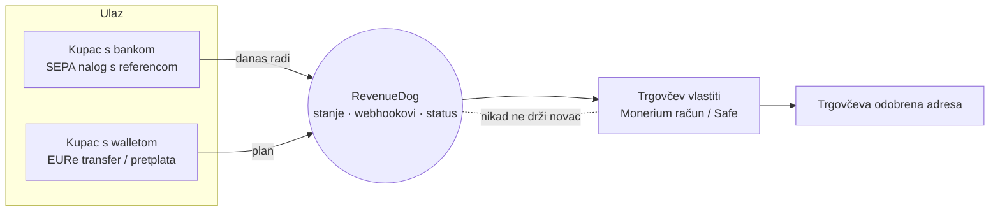

# 01 · Teza

## U jednoj rečenici

**RevenueDog je za bankovne i onchain uplate ono što je RevenueCat za in-app kupnje.** Drži
poslovnu logiku naplate: intente, reference, routing, webhookove i status uživo. Novac nikad
ne prolazi kroz njega, nego ide izravno trgovcu na njegov vlastiti regulirani račun.

## Zašto je usporedba s RevenueCatom točna, a ne samo zgodna

RevenueCat nikad nije držao novac developera. Isplatu developeru rade Apple i Google, a
RevenueCat drži **stanje** (tko je što kupio, je li pretplata aktivna) i **DX** (SDK,
webhookovi, paywall).

MPT je ista poslovna logika na drugom railu:

| | RevenueCat | MPT / RevenueDog |
|---|---|---|
| Tko drži račun s novcem | developer (njegov App Store / Play račun) | trgovac (njegov Monerium račun, IBAN, Safe) |
| Tko regulirano miče novac | Apple, Google | Monerium (EMI, EURe je MiCA EMT) |
| Što radi orkestrator | validira kupnju, drži stanje, šalje webhookove | prati SEPA nalog i mint, forwarda na odobrenu adresu, šalje webhookove |
| Drži li orkestrator novac | ne | ne |
| Cijena | besplatno do $2.500 MTR, zatim 1 % | besplatno do 2.500 € mjesečno, zatim 1 % |

## Zašto pas

Igra riječi radi na tri razine, i svaka nosi nešto drugo:

1. **Cat → Dog.** Developeri odmah znaju kategoriju („aha, RevenueCat, ali za…"). Mačka i
   pas su prirodan par: isti posao, drukčiji temperament.
2. **Pas je semantički bolji za ovaj proizvod nego mačka.** Pas **donosi** (fetch), **čuva**
   (guard), **vjeran je vlasniku** i **nosi pločicu s adresom vlasnika**. To je doslovno opis
   MPT-a:
   - referenca `mpt:0x<trgovac>?sid=…` je pločica na ogrlici koja kaže kome se vraća
   - router donosi novac vlasniku i ne zadržava ga
   - whitelist i fail-closed su čuvar koji ne pušta stranca

   Razrada je u [05 · Pseći rječnik](05-psec-rjecnik.md).
3. **Dog → DOGE.** Dogecoin i „doge" meme su najprepoznatljiviji kripto pas na internetu.
   DOGE je ujedno i američki „Department of Government Efficiency". Odatle šala o
   učinkovitosti: *DOGE je rezao državni otpad, RevenueDOGE reže otpad u plaćanjima.* Kartica
   trgovca košta 1,5 % + 0,25 €, a MPT do 2.500 € mjesečno košta 0 €. To je najjača i
   najrizičnija razina; vidi [04](04-arhitektura-brenda.md) i [08](08-ime-i-rizici.md).

## Zašto sad

- **Stablecoini su u EU-u postali regulirani.** MiCA EMT režim radi, a EURe je izdan kao
  e-novac preko Moneriuma.
- **SEPA Instant je od 9. 10. 2025. obavezan.** U eurozoni ga banka mora nuditi po cijeni
  običnog naloga, a Verification of Payee kupcu pokazuje ime trgovca. Bankovna uplata postaje
  brza i manje sklona prijevari.
- **RevenueCat eksplicitno ne ide u kripto.** U objavi o virtualnim valutama pišu da se ne
  pivotiraju u kripto.
- **Coinbase Commerce je 31. 3. 2026. zatvorio self-custodial checkout izvan SAD-a i
  Singapura.** U EU-u je mjesto za non-custodial naplatu prazno.
- **Svi ostali su wallet-first i USDC/US.** Nitko ne radi *bank-first, EUR, novac izravno na
  trgovčev regulirani račun, multi-tenant, MIT*.

## Obrat u odnosu na lipanjski plan

Lipanjski brief zamišljao je **wallet-first** RevenueDog: korisnik ima wallet, session key i
paymaster, a temeljna intelektualna vrijednost (core IP) su onchain pretplate.

MPT je u stvarnosti dokazao **bank-first**: kupac nema wallet, plaća iz banke, a onchain je
samo settlement kod trgovca. Taj ulaz je širi, jer ga ima svaki Europljanin s IBAN-om, i jači
je za trgovce.

Zato RevenueDog globalno ima dva ulaza:

## Tri rečenice koje moraju ostati istinite

1. **Ne držimo novac.** ITalk / RevenueDog je non-custodial software provider; regulirane
   funkcije obavlja Monerium.
2. **0 € je samo na Revolut putu.** Iz klasične hrvatske banke kupac plaća nalog svojoj
   banci.
3. **Danas su to jednokratna plaćanja.** Pretplate, SDK-ovi i dashboard su plan; vidi
   [09](09-roadmap.md).
