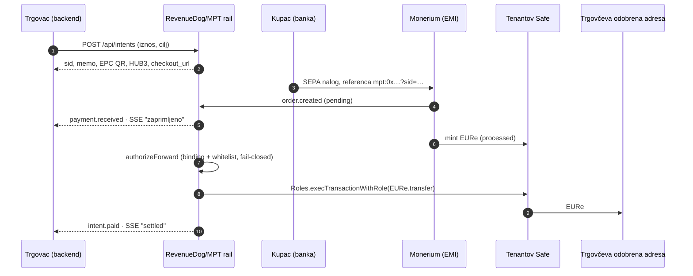

# 02 · Proizvod danas (MPT, stanje 11. 10. 2026.)

> Preslika iz `~/git/domovinatv/pay.domovina.ai`. Putanje su relativne na taj repo. Kad se
> kod promijeni, ovaj dokument se ažurira.

## Što je to

MPT je Cloudflare Worker (`pay-domovina-backend`, `mpt.domovina.ai`) koji SEPA bankovnu
uplatu pretvara u EURe isporučen na unaprijed odobrenu adresu na Gnosis Chainu:

- trgovac stvori **payment intent**
- kupac plati na tenantov Monerium IBAN s referencom `mpt:0x<cilj>?sid=<sid>`
- Monerium mintira EURe na tenantov prihvatni Safe
- rail provjeri uplatu protiv intenta i whiteliste (fail-closed) i forwarda `EURe.transfer`
  preko Zodiac Roles modula
- trgovac dobiva potpisane webhookove i SSE status

Kod je javan pod licencom MIT (`LICENSE`); brand asseti su CC BY-ND 4.0. Prvi commit je
30. 4. 2026., a do danas ih je oko 374.

## Tok novca

**Rubni slučajevi** (`backend/src/intents/outbound.ts`):

| Slučaj | Što se dogodi | Događaj |
|---|---|---|
| Premalo plaćeno | intent ostaje `pending` | `payment.underpaid` |
| Previše plaćeno | intent je `paid`, s `overpaid_cents` | `intent.paid` |
| Plaćeno nakon isteka | forward se svejedno obavi | `payment.late` |
| Monerium odbije nalog | novac se vraća platitelju | `payment.rejected` |
| Uplata bez reference | stray resolver (ADR 0018) je poveže s intentom istog tenanta po točnom iznosu i vremenu; ako kandidata nema ili ih je više, uplata se parkira | `intent.paid` ili `forward.blocked` |
| Bilo što ne prođe provjeru | parkirano, uz alert operateru | `forward.blocked` |
| Trajni QR kampanje (`cmp:0x<safe>?id=…`) | jedan QR za mnogo uplata | `contribution.sepa` |

## API

| Endpoint | Što radi |
|---|---|
| `POST /api/intents` | stvara intent; tijelo: `target_address`, `amount_eur`, `label`, `metadata`, `expires_in_seconds` |
| `GET /api/intents/:sid` | snapshot statusa |
| `GET /api/intents/:sid/stream` | SSE stream uživo (Durable Object po `sid`-u) |
| `GET /api/intents/campaign-qr` | trajni QR kampanje |
| `GET /checkout/:sid` | hostani checkout: EPC QR, HUB3 PDF417 i status uživo |

- **Granice:** iznos je veći od 0 € i najviše 10.000 €. TTL je zadano 15 min, a podesiv od
  60 s do 24 h. `sid` ima 6–32 znaka, jer se onchain sprema kao bytes32.
- **Faze statusa** (`intents/stage.ts`): `awaiting_payment → received_processing → minted →
  forwarding → settled`, te `rejected` i `expired`. Svaki korak navodi **tko trenutno drži
  novac** (`bank | monerium | blockchain | relay | recipient`). Pravilo dizajna: nikad ne
  prikazivati lažni napredak dok rail ne vidi novac.
- **Webhookovi:** `payment.received`, `intent.paid`, `payment.late`, `payment.underpaid`,
  `payment.rejected`, `contribution.sepa`, `forward.blocked`.
  - Potpis je po **Standard Webhooks** shemi (svix): HMAC-SHA256, ključ `whsec_`.
  - Isporuku nosi trajni outbox: 9 pokušaja kroz otprilike 47 h, zasebni endpoint po tenantu.
- **Ključevi tenanta:** `pk_` / `sk_`. Ključ *identificira* tenanta; sigurnosna granica je
  whitelist adresa.

## Tenant model (ADR 0016, 0017)

Tenant je pravna osoba koja ima vlastiti Monerium odnos (KYB). Svaki tenant ima:

- vlastiti Monerium račun i IBAN
- prihvatni Safe
- Zodiac Roles modul
- router ključ
- webhook endpoint
- listu odobrenih adresa za isplatu

Tajne su šifrirane u bazi (AES-256-GCM), pa onboarding tenanta ne traži deploy. Tenantovi
potpisnici mogu **jednom transakcijom isključiti MPT** (`disableModule` / `revokeRole`), bez
pitanja MPT-a.

**Sigurnosni slojevi:**

- **binding + whitelist:** adresa upisana u SEPA referencu ne radi ništa bez prethodnog API
  poziva
- **fail-closed parkiranje:** sve što ne prođe provjeru stoji, ništa se ne šalje „na sreću"
- **atomic latch:** po narudžbi postoji najviše jedan živi forward
- **detektor odljeva (ADR 0019, faza 0):** svake 2 minute uspoređuje odljeve sa Safea s
  evidencijom forwarda

U planu je off-cloud potpisnik: kvorum Android StrongBox telefona kao WebAuthn potpisnika
Safea.

## Izmjerene produkcijske brojke

| Brojka | Izvor |
|---|---|
| „Zaprimljeno" 0 s od placedAt (oko 5 s nakon „Pošalji" u Revolutu) | ADR 0018 |
| Od uplate do `paid` oko 12 s | ADR 0017, ADR 0018 |
| Monerium placed → processed: medijan 9 s, p95 26 s (n = 44) | `docs/research/2026-09-monerium-first-iban-screening.md` |
| Prva uplata s novog IBAN-a ide na ručni pregled: od 1 min 23 s do 8 h 11 min (5/5 slučajeva) | isto |
| Oko 1 xDAI gasa pokriva tisuće forwarda | ADR 0017 |
| Do 1. 8. 2026.: 43 narudžbe, 41 forward | ADR 0016 |

## Status: što smije u copy

| Mogućnost | Status |
|---|---|
| Intent API, EPC QR, hostani checkout, polling, SSE | **radi u produkciji** |
| Webhookovi s trajnim outboxom | **radi u produkciji** |
| Whitelist, fail-closed, binding | **radi u produkciji** |
| Stray resolver i ručno preusmjeravanje | **radi u produkciji** (od 8. 10. 2026.) |
| Detektor odljeva | **radi u produkciji** |
| QR kampanje (`cmp:`) | radi u kodu, bez produkcijske upotrebe |
| HUB3 PDF417 | radi; koristan tek uz hrvatski IBAN |
| Multi-tenant rail (vlastiti Monerium, webhook i potpisnik po tenantu) | **napisano, isključeno** (`MULTI_TENANT_RAIL=0`) dok prvi vanjski tenant ne prođe KYB; ITalk je jedini aktivni tenant |
| Shopify app | napravljen, nikad deployan |
| Off-cloud M-of-N potpisnik | plan (ADR 0019) |
| Listener za hrvatski IBAN bez minta | plan (ADR 0020) |
| WooCommerce | samo plan |
| Povrati, otkazivanje i produženje intenta | **nema** |
| Pretplate / recurring | **nema** |
| Klijentski SDK-ovi | **nema** (REST + QR) |
| Dashboard za trgovca | **nema** (postoji samo operaterski `/admin`) |
| Multi-chain | **nema** (Gnosis i testnet Chiado) |
| Naplata MPT naknade (1 % iznad 2.500 €) | **nema**; cjenik je objavljen, a tehnički je danas 0 % |

## Wallet strana (isti repo, sloj ispod)

- **Passkey + Safe wallet** na Gnosisu (`wallet.domovina.ai`): bez seed fraze, relayer plaća
  gas.
- **White-label kao podaci** (ADR 0007, 0015): brend se bira po hostnameu.
- **Iframe SDK** (ADR 0009): `Domovina.connect()`.

To je zametak „wallet ulaza" iz [01](01-teza.md). Za pretplate fali još recurring primitiv.

## Regulatorni okvir

ITalk d.o.o. je **non-custodial software provider**. Ne radi KYC/AML i ne drži novac.
Regulirane funkcije obavlja **Monerium EMI ehf.**, islandski EMI s passportom u EEA, koji
izdaje EURe kao e-novac (MiCA EMT).

Smjer je **merchant-direct**: svaki tenant ima vlastiti KYB i IBAN, pa ITalk izlazi iz toka
novca (ADR 0017).
