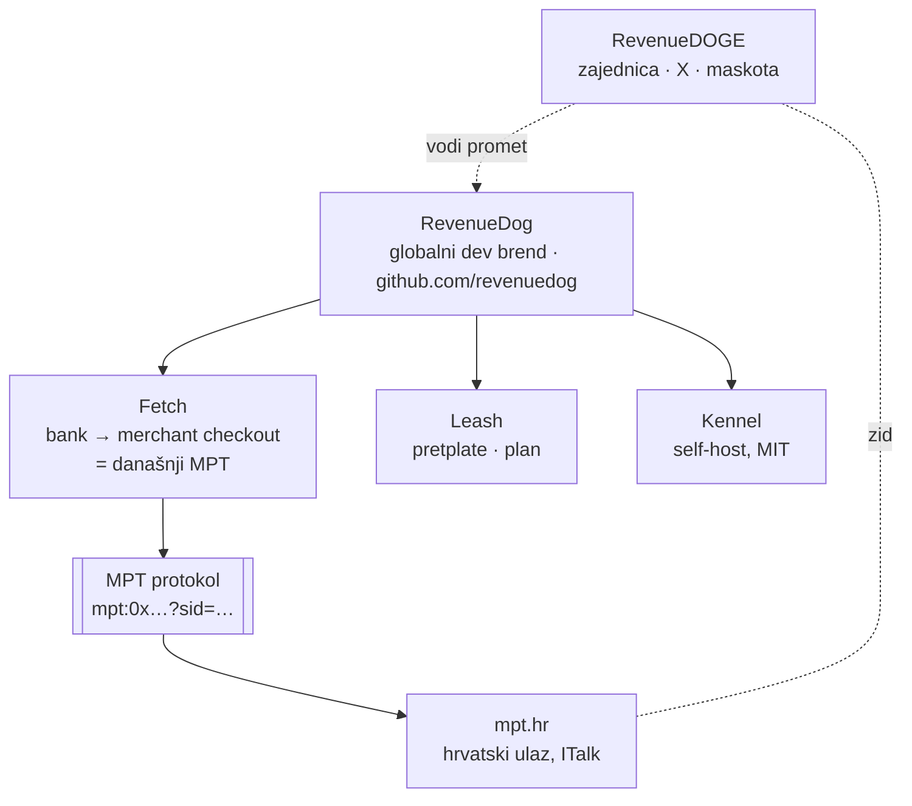

# 04 · Arhitektura brenda

## Igrači

| Ime | Što je | Publika | Ton | Danas |
|---|---|---|---|---|
| **MPT** (Mint Pay Transfer) | proizvod ITalka, SEPA → EURe orkestrator; ujedno format reference `mpt:0x…?sid=…` | hrvatski trgovci, udruge, developeri | ozbiljan, airKUNA stil | live na mpt.hr |
| **airKUNA** | rail i regulatorna priča (Monerium model) | EMI, regulator, banke | čisto, regulirano | airkuna.com |
| **RevenueDog** | globalni developerski brend „RevenueCat za onchain" | developeri, globalno | ozbiljna infra | GH org, 0 repoa |
| **RevenueDOGE** | dosjetka na kvadrat: Cat → Dog → DOGE | kripto/dev zajednica, X | meme, zabava | GH org, 0 repoa |

Lipanjska strategija postavila je **zid**: airKUNA i RevenueDog su „regulirana i ozbiljna"
strana, a RevenueDOGE je meme koji smije voditi promet *prema* RevenueDogu, ali ne smije
dotaknuti regulatornu priču.

Matija je 10. 10. 2026. rekao da mu je RevenueDOGE možda čak i draži. Taj zid je sada
glavno pitanje.

## Novo od jučer: ime „RevenueDog" nije samo naše

Istraživanje 11. 10. 2026. (detalji u [08](08-ime-i-rizici.md)) našlo je tri projekta iz
2026. koja koriste isto ime za istu dosjetku:

- `vm542/RevenueDog`: „open-source, self-hostable alternative to RevenueCat", s 🐕 logom
- `githubYiheng/revenue-dog-flutter`: Flutter SDK `revenue_dog`, API-kompatibilan s
  `purchases_flutter`, u aktivnom razvoju
- `RevenueDogAi`: agentska ekonomija na Solani

Uz to su `revenuedog.com` i `revenue.dog` registrirani, a vlasnik nije poznat.

**RevenueDOGE je, koliko se vidi, potpuno slobodan:** ime, `revenuedoge.com` i
`revenuedoge.io`. Posljedica: ozbiljno ime je gužva, a meme ime je čisto. To okreće lipanjsku
logiku.

## Opcije

### A · Sve odvojeno (status quo)

MPT ostaje hrvatski proizvod. RevenueDog i RevenueDOGE ostaju papir.

- **Za:** nula rizika.
- **Protiv:** rad na MPT-u ne gradi nikakvu globalnu priču, a ime „RevenueDog" u međuvremenu
  zauzimaju drugi.

### B · RevenueDog je kuća, MPT je protokol, RevenueDOGE je megafon

Usporedba: „Stripe" i „Stripe Checkout", ili „Visa" i „VisaNet". Prefiks `mpt:` ostaje
zauvijek kompatibilan, a MPT postaje ime protokola kao što je ACH ime mreže.

- **Za:** poštuje zidove i ne mijenja ništa što radi. RevenueDog dobiva svoj prvi pravi
  modul.
- **Protiv:** glavno ime je u gužvi i blizu žiga RevenueCata.

### C · RevenueDOGE je kuća, s pripitomljenim značenjem

Glavni brend je RevenueDOGE, ali DOGE dobiva **vlastito, nepolitičko značenje** (backronim).
Šala o učinkovitosti ostaje kao podtekst, a ne kao zastava. Kandidati:

| Backronim | Zašto radi |
|---|---|
| **D**irect-to-**O**wner **G**ross **E**arnings | srž proizvoda: novac ide izravno vlasniku, u bruto iznosu, bez kartičnog reza |
| **D**elivered **O**nchain, **G**uarded **E**nd-to-end | fetch + guard u četiri slova |
| **D**on't **O**wn **G**uest **E**uros | non-custodial kao šala; zvuči kao pravilo kuće |

Zid se seli: **pravne i regulatorne površine** (ugovori, KYB, Monerium, banke, impresum)
uvijek govore „MPT by ITalk d.o.o." Developerski i community nastup govori „RevenueDOGE".

- **Za:**
  - ime je slobodno i nezaboravno
  - dosjetka radi na tri razine
  - „efficiency" priča je doslovno istinita, jer trgovac umjesto 1,5 % + 0,25 € plaća 0 €
    do 2.500 € mjesečno
- **Protiv:**
  - u EU B2B okruženju (banke, Monerium, hrvatski trgovci) DOGE se čita kao memecoin ili
    kao Musk-politika
  - verzalni „DOGE" upućuje ravno na političku kraticu
  - rizik je najveći baš kod publike koja plaća

### D · Puni rebrand MPT → RevenueDog/DOGE

Gubi mpt.hr, postojeću objavu i `mpt_hr`, i odmah obećava pretplate i SDK-ove koji ne
postoje. **Ne preporučuje se.**

## Usporedba

| | A | B | C | D |
|---|---|---|---|---|
| Slobodno ime | — | ✗ gužva | ✓ | ovisi |
| Blizina žiga RevenueCata | — | visoka | srednja (doge razvodnjava) | visoka |
| Pamtljivost | nisko | srednje | **vrlo visoko** | srednje |
| Regulatorni rizik | nula | nizak | srednji (rješiv zidom) | visok |
| Gradi globalnu priču iz postojećeg rada | ✗ | ✓ | ✓ | ✓ |
| Obećava nepostojeće | ne | malo | malo | puno |

## Preporuka

**B kao struktura, a za ime odluka između RevenueDog i RevenueDOGE nakon tri provjere.**

U svakom slučaju:

1. **MPT ostaje ime protokola i hrvatskog proizvoda.** Prvi modul globalnog brenda zove se
   po poslu (Fetch), a ne po pretplatama koje ne postoje.
2. **Regulatorne površine uvijek govore „MPT by ITalk d.o.o."** Pas, DOGE i dosjetke
   pripadaju developerima i zajednici.
3. **Pas je maskota bez obzira na ime.** Pseći rječnik ([05](05-psec-rjecnik.md)) radi i za
   RevenueDog i za RevenueDOGE.

Ime za glavni nastup bira se nakon ovoga:

- **Žig** (EUIPO / USPTO, razredi 9, 36 i 42) za „RevenueDog" i „RevenueDOGE". Ako je
  RevenueDog zbog RevenueCata nebranjiv, to presuđuje.
- **`revenuedog.com` nije Matijin.** Registriran je 6. 12. 2020. kod Cloudflarea i ističe
  6. 12. 2026.; vlasnik je nepoznat.
- **Test na deset ljudi iz ciljne publike:** pet hrvatskih trgovaca i pet developera. Kako
  čitaju „RevenueDOGE"? Ako trgovci vide „kripto kockarnicu", RevenueDOGE ostaje megafon
  (B). Ako vide šalu, C je otvoren.

Domene se zasad **ne kupuju** (Matija, 11. 10. 2026.): prvo kombinacija koju netko stvarno
kupuje, a domena je najlakši dio. Slobodne su bile 11. 10. 2026.: `revenuedoge.com`,
`revenuedoge.io` i `revenuedog.dev`.
