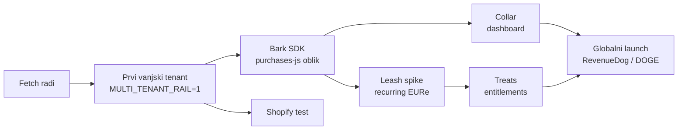

# 09 · Roadmap proizvoda: od MPT-a do RevenueDoga

Moduli su imenovani psećim rječnikom ([05](05-psec-rjecnik.md)). Imena su radna.

| Modul | Što | Stanje | Sljedeći korak |
|---|---|---|---|
| **Fetch** | bank → merchant checkout: intent, SEPA s tagom, mint, forward, webhookovi, SSE | **radi** (MPT) | uključiti multi-tenant rail uz prvog vanjskog tenanta |
| **Sniff** | uplate bez reference, lost & found | **radi** (ADR 0018) | `client_ref` učenje platitelja (plan u ADR 0018) |
| **Kennel** | self-host, MIT | kod je javan | vodič „run your own kennel" i hostani vs self-host stranica |
| **Bark SDK** | tanki JS/TS SDK: `createIntent`, SSE status, provjera potpisa webhooka; oblik zrcali `purchases-js` | ✗ | **prvi opipljivi RevenueDog artefakt**, bez ikakvog rebranda MPT-a |
| **Collar** | merchant dashboard: intenti, uplate, parkirano, webhook log | ✗ (postoji samo operaterski admin) | read-only pogled po tenantu |
| **Plugins** | Shopify, WooCommerce | Shopify napravljen, nedeployan | prvi Shopify test |
| **Leash** | pretplate: recurring allowance na EURe (Safe modul ili spend permission), naplata po ciklusu, dunning | ✗ (lipanjski „core IP") | spike na Gnosisu + EURe |
| **Treats** | entitlements i offerings (RC model) | ✗ | tek nakon Leasha |
| **Pack** | off-cloud M-of-N potpisnik na telefonima | plan (ADR 0019) | faza 1 spike |
| **Local bark** | hrvatski IBAN listener bez minta | plan (ADR 0020) | — |

## Redoslijed koji preporučujem

**Zašto ovim redom:**

- Bez vanjskog tenanta nema dokaza za „multi-tenant orkestrator".
- SDK je najjeftiniji korak koji ime „RevenueDog" čini opipljivim za developere.
- Leash je ono što ime obećava, ali tržište pretplata je gužva ([07](07-trziste.md)).
- Globalni launch dolazi tek kad postoje barem Fetch + SDK + jedan stvarni trgovac.

## Što je promijenjeno u odnosu na lipanjski plan

| Lipanj 2026. | Sada |
|---|---|
| Wallet-first; recurring je prvi spike (Q3) | **Bank-first** već radi; recurring je drugi val |
| „Backend gradimo sami" | Backend postoji: intenti, webhookovi, tenanti |
| SDK skeleton u Q4 (fork `purchases-js`) | i dalje vrijedi, i sad ima stvarni API ispod sebe |
| RevenueDOGE launch 2027. | ovisi o odluci iz [04](04-arhitektura-brenda.md) |
| Design partneri: creator pilot „mpt (glazba)", BK, Iva | pilot repoi su mirni od lipnja; stvarni prvi tenanti su trgovci i udruge preko mpt.hr |
